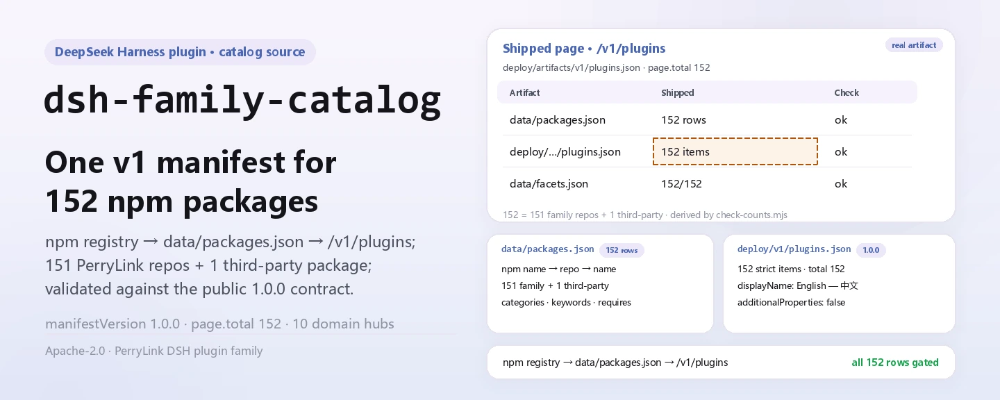
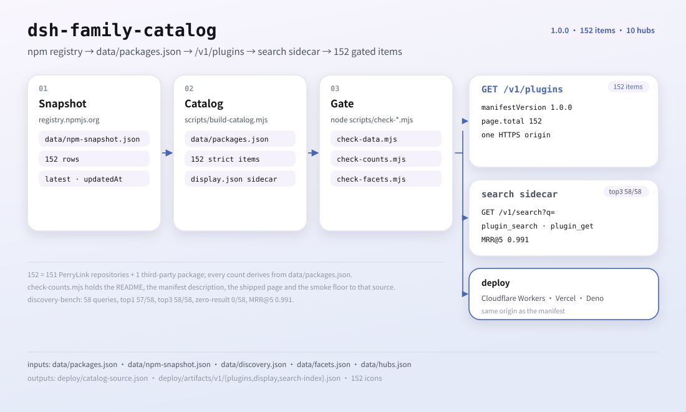

<picture>
  <source media="(prefers-color-scheme: dark)" srcset="docs/assets/dsh-family-catalog-hero-en-dark.webp">
  
</picture>

# dsh-family-catalog

Fuente de catálogo estándar de DSH Community Market para la familia de plugins PerryLink DSH: 152 paquetes npm (151 repositorios de la familia + 1 de terceros), validados contra el contrato público v1.

[English](README.md) · [简体中文](README-zh.md) · [Español](README-es.md) · [Português](README-pt.md) · [हिन्दी](README-hi.md)

> Este archivo es la entrada localizada en español; el cuerpo técnico completo vive en el [README.md](README.md) en inglés y no se repite aquí.

<picture>
  <source media="(prefers-color-scheme: dark)" srcset="docs/assets/dsh-family-catalog-flow-v5-dark.svg">
  
</picture>

*Estructura: npm registry → data/packages.json → artefactos de despliegue → puertas → sidecar de búsqueda. Las etiquetas del diagrama son nombres de script, rutas y endpoints reales, por eso una sola imagen sirve para los cinco idiomas.*

## Estado de mantenimiento: herramienta interna de la familia

*Animación: las puertas de solo lectura y el CLI de búsqueda del propio repositorio, re-ejecutados el 2026-11-21 — node scripts/check-counts.mjs, node scripts/check-facets.mjs y node scripts/search.mjs "IATF 16949" --limit=3. stdout real, sin llamadas de red.*

Este repositorio es una **herramienta interna de la familia**, no un producto retirado: convierte los 152 paquetes npm en la fuente de catálogo estándar de DSH Community Market (151 repositorios de la familia + 1 paquete de terceros). Aparecer junto a los demás no implica respaldo.

## Notas de cumplimiento

Se respeta el contrato público v1: `manifestVersion` / `schemaVersion` `1.0.0`, solo campos permitidos por el esquema (`additionalProperties: false`), sin órdenes de instalación ni datos ejecutables; el par chino puro y los metadatos de estado viven en el sidecar `display.json`.

## Compilación

`node scripts/build-catalog.mjs` genera `deploy/catalog-source.json` y `deploy/artifacts/v1/plugins.json`; `data/` y `deploy/` deben actualizarse en el mismo commit. Los comandos completos y las puertas están en la sección Build del `README.md` en inglés.

## Despliegue

En producción: `https://perrylink-dsh-catalog.perrylink.workers.dev`, desplegado automáticamente por `.github/workflows/deploy.yml` en Cloudflare Workers; Vercel (reescritura estática) y Deno Deploy son canales alternativos. El manifiesto y su endpoint deben compartir un único origen HTTPS.

## Uso en DSH Desktop

En DSH Desktop: Mercado → **Sources** → añadir `https://perrylink-dsh-catalog.perrylink.workers.dev/catalog-source.json` y seleccionarlo para navegar las 152 entradas. La navegación es de solo lectura; la instalación pasa por la verificación npm y la confirmación del usuario del propio Mercado.

## Búsqueda de descubrimiento y MCP

`data/discovery.json`, `data/facets.json` (cobertura 152/152) y `data/hubs.json` (10 hubs de dominio) forman el sidecar de búsqueda: `GET /v1/search`, `GET /v1/plugin` y el MCP stdio con `plugin_search` / `plugin_get`.

## Nota en chino

El `README.md` en inglés incluye una sección técnica completa en chino; este archivo solo es la entrada localizada y no repite ese cuerpo.

## Licencia

Apache-2.0. Los datos del catálogo provienen de npm registry y de los repositorios de plugins de PerryLink; la línea actual de la familia es `dsh-v0.1.7-rc.2`.

## Familia de plugins PerryLink DSH

Este repositorio forma parte de la familia de plugins de DeepSeek Harness de [PerryLink](https://github.com/PerryLink); el roster completo (desplegable) está en el [README.md](README.md) en inglés.

[Privacy](PRIVACY.md) · [Security](SECURITY.md) · [Contributing](CONTRIBUTING.md) · [Changelog](CHANGELOG.md)
