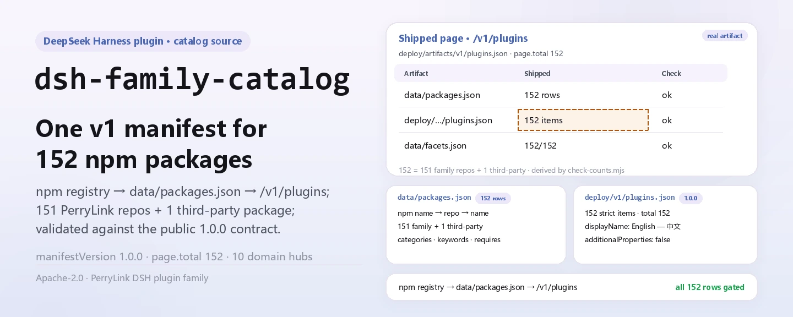
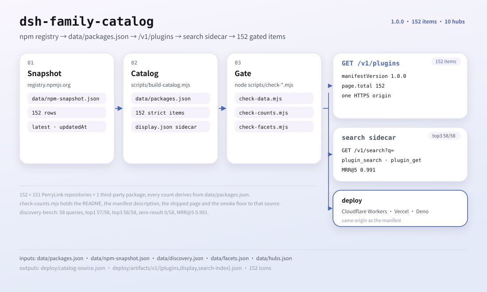

<picture>
  <source media="(prefers-color-scheme: dark)" srcset="docs/assets/dsh-family-catalog-hero-en-dark.webp">
  
</picture>

# dsh-family-catalog

PerryLink DSH प्लगइन परिवार के लिए DSH Community Market का मानक कैटलॉग स्रोत: 152 npm पैकेज (151 परिवार रिपॉज़िटरी + 1 तृतीय-पक्ष), सार्वजनिक v1 अनुबंध के अनुसार सत्यापित।

[English](README.md) · [简体中文](README-zh.md) · [Español](README-es.md) · [Português](README-pt.md) · [हिन्दी](README-hi.md)

> यह फ़ाइल हिन्दी स्थानीयकृत प्रवेश है; पूरा तकनीकी विवरण अंग्रेज़ी [README.md](README.md) में है और यहाँ दोहराया नहीं गया है।

<picture>
  <source media="(prefers-color-scheme: dark)" srcset="docs/assets/dsh-family-catalog-flow-v5-dark.svg">
  
</picture>

*संरचना: npm registry → data/packages.json → डिप्लॉय आर्टिफ़ैक्ट → गेट → सर्च साइडकार। चित्र के लेबल असली स्क्रिप्ट नाम, पथ और endpoint हैं, इसलिए एक ही चित्र पाँचों भाषाओं के लिए है।*

## रखरखाव स्थिति: परिवार-आंतरिक उपकरण

*एनिमेशन: रिपॉज़िटरी के अपने केवल-पठन गेट और सर्च CLI का 2026-11-21 को दोबारा रन — node scripts/check-counts.mjs, node scripts/check-facets.mjs, node scripts/search.mjs "IATF 16949" --limit=3। असली stdout, कोई नेटवर्क कॉल नहीं।*

यह रिपॉज़िटरी परिवार के लिए **आंतरिक उपकरण** है, सेवानिवृत्त नहीं: यह 152 npm पैकेजों को DSH Community Market के मानक कैटलॉग स्रोत में बदलती है (151 परिवार रिपॉज़िटरी + 1 तृतीय-पक्ष पैकेज)। साथ सूचीबद्ध होना समर्थन नहीं है।

## अनुपालन नोट्स

सार्वजनिक v1 अनुबंध का पालन: `manifestVersion` / `schemaVersion` = `1.0.0`, केवल स्कीमा-अनुमत फ़ील्ड (`additionalProperties: false`), कोई इंस्टॉल कमांड या निष्पादन-योग्य डेटा नहीं; शुद्ध चीनी जोड़ी और स्टेटस मेटाडेटा `display.json` साइडकार में रहते हैं।

## बिल्ड

`node scripts/build-catalog.mjs` `deploy/catalog-source.json` और `deploy/artifacts/v1/plugins.json` बनाता है; `data/` और `deploy/` एक ही commit में अपडेट होते हैं। पूरे कमांड और गेट अंग्रेज़ी `README.md` के Build सेक्शन में हैं।

## डिप्लॉय

लाइव: `https://perrylink-dsh-catalog.perrylink.workers.dev`, `.github/workflows/deploy.yml` द्वारा Cloudflare Workers पर स्वतः डिप्लॉय; Vercel (static rewrite) और Deno Deploy वैकल्पिक चैनल हैं। manifest और उसका endpoint एक ही HTTPS origin पर होने चाहिए।

## DSH Desktop में उपयोग

DSH Desktop में Market → **Sources** → `https://perrylink-dsh-catalog.perrylink.workers.dev/catalog-source.json` जोड़ें और चुनें, फिर 152 प्रविष्टियाँ ब्राउज़ करें। ब्राउज़िंग केवल-पठन है; इंस्टॉल Market की अपनी npm पहचान जाँच और उपयोगकर्ता पुष्टि से होता है।

## खोज सर्च और MCP

`data/discovery.json`, `data/facets.json` (152/152 कवरेज) और `data/hubs.json` (10 डोमेन hub) मिलकर खोज साइडकार बनाते हैं: `GET /v1/search`, `GET /v1/plugin` और stdio MCP के `plugin_search` / `plugin_get`।

## चीनी नोट

अंग्रेज़ी `README.md` में पूरा चीनी तकनीकी अनुभाग है; यह फ़ाइल केवल स्थानीयकृत प्रवेश है और उस मुख्य भाग को दोहराती नहीं।

## लाइसेंस

Apache-2.0। कैटलॉग डेटा npm registry और PerryLink प्लगइन रिपॉज़िटरी से आता है; परिवार की वर्तमान लाइन `dsh-v0.1.7-rc.2` है।

## PerryLink DSH प्लगइन परिवार

यह रिपॉज़िटरी [PerryLink](https://github.com/PerryLink) के DeepSeek Harness प्लगइन परिवार का हिस्सा है; पूरा (विस्तार-योग्य) रोस्टर अंग्रेज़ी [README.md](README.md) में है।

[Privacy](PRIVACY.md) · [Security](SECURITY.md) · [Contributing](CONTRIBUTING.md) · [Changelog](CHANGELOG.md)
