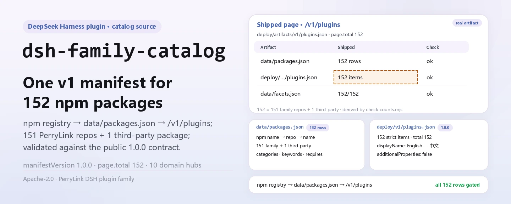
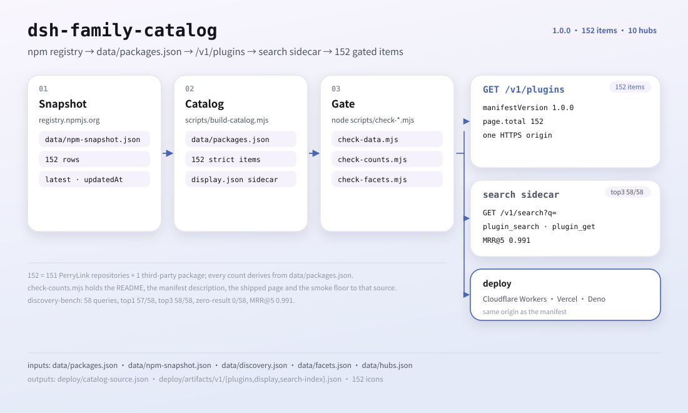

<picture>
  <source media="(prefers-color-scheme: dark)" srcset="docs/assets/dsh-family-catalog-hero-en-dark.webp">
  
</picture>

# dsh-family-catalog

Fonte de catálogo padrão do DSH Community Market para a família de plugins PerryLink DSH: 152 pacotes npm (151 repositórios da família + 1 de terceiros), validados contra o contrato público v1.

[English](README.md) · [简体中文](README-zh.md) · [Español](README-es.md) · [Português](README-pt.md) · [हिन्दी](README-hi.md)

> Este arquivo é a entrada localizada em português; o corpo técnico completo está no [README.md](README.md) em inglês e não é repetido aqui.

<picture>
  <source media="(prefers-color-scheme: dark)" srcset="docs/assets/dsh-family-catalog-flow-v5-dark.svg">
  
</picture>

*Estrutura: npm registry → data/packages.json → artefatos de deploy → portões → sidecar de busca. Os rótulos do diagrama são nomes reais de script, caminhos e endpoints, então uma única imagem serve aos cinco idiomas.*

## Estado de manutenção: ferramenta interna da família

*Animação: os portões somente leitura e o CLI de busca do próprio repositório, reexecutados em 2026-11-21 — node scripts/check-counts.mjs, node scripts/check-facets.mjs e node scripts/search.mjs "IATF 16949" --limit=3. stdout real, sem chamadas de rede.*

Este repositório é uma **ferramenta interna da família**, não um produto aposentado: converte os 152 pacotes npm na fonte de catálogo padrão do DSH Community Market (151 repositórios da família + 1 pacote de terceiros). Estar na mesma lista não implica endosso.

## Notas de conformidade

O contrato público v1 é respeitado: `manifestVersion` / `schemaVersion` `1.0.0`, somente campos permitidos pelo esquema (`additionalProperties: false`), sem comandos de instalação ou dados executáveis; o par chinês puro e os metadados de status ficam no sidecar `display.json`.

## Build

`node scripts/build-catalog.mjs` gera `deploy/catalog-source.json` e `deploy/artifacts/v1/plugins.json`; `data/` e `deploy/` devem ser atualizados no mesmo commit. Os comandos completos e os portões estão na seção Build do `README.md` em inglês.

## Implantação

Em produção: `https://perrylink-dsh-catalog.perrylink.workers.dev`, implantado automaticamente por `.github/workflows/deploy.yml` no Cloudflare Workers; Vercel (reescrita estática) e Deno Deploy são canais alternativos. O manifesto e seu endpoint devem compartilhar uma única origem HTTPS.

## Uso no DSH Desktop

No DSH Desktop: Mercado → **Sources** → adicionar `https://perrylink-dsh-catalog.perrylink.workers.dev/catalog-source.json` e selecioná-lo para navegar as 152 entradas. A navegação é somente leitura; a instalação passa pela verificação npm e pela confirmação do usuário do próprio Mercado.

## Busca de descoberta e MCP

`data/discovery.json`, `data/facets.json` (cobertura 152/152) e `data/hubs.json` (10 hubs de domínio) formam o sidecar de busca: `GET /v1/search`, `GET /v1/plugin` e o MCP stdio com `plugin_search` / `plugin_get`.

## Nota em chinês

O `README.md` em inglês inclui uma seção técnica completa em chinês; este arquivo é apenas a entrada localizada e não repete esse corpo.

## Licença

Apache-2.0. Os dados do catálogo vêm do npm registry e dos repositórios de plugins da PerryLink; a linha atual da família é `dsh-v0.1.7-rc.2`.

## Família de plugins PerryLink DSH

Este repositório faz parte da família de plugins do DeepSeek Harness da [PerryLink](https://github.com/PerryLink); o roster completo (expansível) está no [README.md](README.md) em inglês.

[Privacy](PRIVACY.md) · [Security](SECURITY.md) · [Contributing](CONTRIBUTING.md) · [Changelog](CHANGELOG.md)
