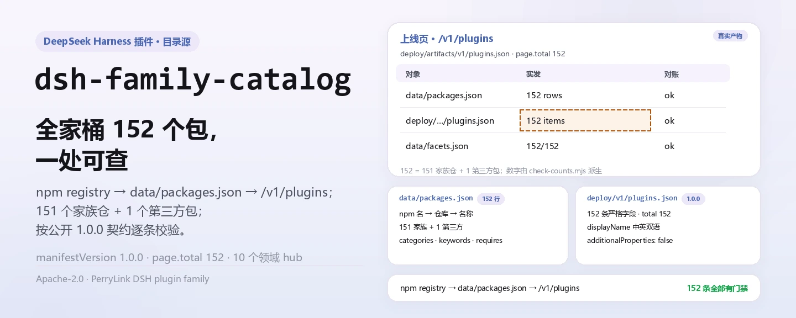

<div align="center">

<picture>
  <source media="(prefers-color-scheme: dark)" srcset="docs/assets/dsh-family-catalog-hero-zh-dark.webp">
  
</picture>

# dsh-family-catalog

[](LICENSE)
[](https://github.com/topics/dsh-plugin)
[](https://gitee.com/perrylink/dsh-family-catalog)
[](https://dshfind.com/plugins/PerryLink/dsh-family-catalog?ref=badge)

[English](README.md) · [简体中文](README-zh.md) · [Español](README-es.md) · [Português](README-pt.md) · [हिन्दी](README-hi.md)

</div>

为 PerryLink DeepSeek Harness 插件家族提供的 [DSH Community Market](https://github.com/anywhere-labs/dsh-desktop/tree/main/dsh-community-market) **标准目录源**：由 npm registry 生成，并按公开 v1 契约 schema 校验。每个条目的 `displayName` 为中英双语（English — 中文），`summary` 带中文句，因此中文在严格的 1.0.0 字段内依然可见、可搜索。公开 schema 不允许的纯中文对与展示/状态元数据放在 `display.json`。

- 清单：`catalog-source.json`（生成产物；见「部署」）
- Provider 页面：`artifacts/v1/plugins.json`（生成产物）
- 真源：`data/packages.json`（npm 名 → 仓库 → 展示名 → 分类）+ `data/npm-snapshot.json`（npm registry 快照）
- 生成器 / 校验器：`scripts/build-catalog.mjs`、`scripts/validate.mjs`、`scripts/check-counts.mjs`
- 部署：线上位于 `https://perrylink-dsh-catalog.perrylink.workers.dev`（Cloudflare Workers，由 `deploy.yml` 自动化；`vercel.json` 提供 Vercel 静态备选；`deploy/deno-worker.js` 是 Deno 单元，可作为手动备选）

<picture>
  <source media="(prefers-color-scheme: dark)" srcset="docs/assets/dsh-family-catalog-flow-v5-dark.svg">
  
</picture>

*结构：npm registry → data/packages.json → 部署产物 → 门禁 → 搜索 sidecar。图中的标注都是真实的脚本名、路径与端点，因此一张图能服务全部五种语言。*

## 维护状态：家族内部工具


*动图：本仓库自带的只读门禁与搜索 CLI 于 2026-11-21 的复跑——node scripts/check-counts.mjs、node scripts/check-facets.mjs、node scripts/search.mjs "IATF 16949" --limit=3。真实 stdout，不联网。*

> **2026-10-05 重新归类——刻意不退役。** 一次针对官方 harness 与更广生态的
> 全家桶审查，把本仓库归类为**家族内部工具**而非产品。它的职责是为 DSH Desktop 的 Community Market 盘点本家族，因此不与第三方目录竞争，也不需要退役。它会继续维护。

### 同一份名册，单一来源

目录是可发现性表面，而不是家族名册的 1:1 投影。它携带 `data/packages.json` 中的 npm 记录（包括社区/第三方记录，以及为兼容旧安装而保留的退役名称）。每份插件 README 都携带同一份折叠名册。

## 合规说明

- 契约：[catalog-provider-contract.md](https://github.com/anywhere-labs/dsh-desktop/blob/main/dsh-community-market/docs/catalog-provider-contract.md)（v1，`manifestVersion`/`schemaVersion` 为 `1.0.0`）。schema 并未在本仓库内 vendored；`scripts/validate.mjs` 镜像 `catalog-source.schema.json` 与 `catalog-provider-page.schema.json` 的结构规则以及跨字段规则（条目 id 唯一、npm 名模式、条目中不含安装命令、仓库 URL 必须为 HTTPS、页面形状）。
- provider 声明 `query.supported = ["cursor","limit"]`、`defaultLimit = maxLimit = 100`、`sorts = []`。端点以每页最多 100 条的 cursor 分页提供完整的 152 条目录（两次请求），使 DSH Desktop 能在不超过运行时每页上限的情况下扫描整个目录。Vercel 静态镜像提供不分页的 152 条 JSON 供浏览；Desktop 请使用 workers.dev manifest。
- 每个条目携带 `package.registry = "npm"` + `package.name` 与规范的 `repository.url`；绝不输出安装命令、shell 片段或可执行数据。
- 每个条目还携带同源的 `media.icon`（`/icons/<slug>.png`，由 `scripts/build-icons.mjs` 确定性生成）；Worker 自己提供这些 PNG，因此图标留在目录源 origin 上，符合市场媒体规则的要求。
- manifest 端点与 manifest 本身必须共享同一个 HTTPS origin（市场规则）。生成的占位端点 `https://replace-with-deploy-origin.invalid/...` 会在部署时被真实部署 origin 替换——请勿把占位 URL 注册进 DSH Desktop。

## 构建

```sh
node scripts/build-catalog.mjs            # placeholder endpoint
node scripts/validate.mjs                 # structural checks
node scripts/build-catalog.mjs https://<your-project>.deno.dev   # real origin
```

`build-catalog.mjs` 会把 manifest 与 provider 页面写到仓库根目录，**并**把两者镜像进 `deploy/`，因此 `deploy/deno-worker.js` 是一个自包含的 Deno Deploy 单元（它的 `./` 导入总能解析）。

`data/npm-snapshot.json` 以 UTF-8 安全的方式刷新：

```sh
node scripts/refresh-snapshot.mjs   # re-fetch every package from registry.npmjs.org
```

> 一个定时 workflow（`.github/workflows/refresh-catalog.yml`）每天运行它，
> 且仅在 registry 发生变化时在 `chore/catalog-refresh` 分支上开一个 PR。
> 它在开 PR 之前运行 data/产物/类型门禁；合并该 PR 会触发部署 workflow。
> 上面的手动命令用于强制刷新。

### 维护 `data/`

`data/packages.json` 与 `data/npm-snapshot.json` 是**一个整体**：新增或改名的包必须在**同一次提交**里带上它的快照行。2026-09-09 连续两次 `main` 部署红灯正是这个原因——先是 `data/packages.json` 里漏了一个逗号，然后是新增包缺了快照行（`Error: npm snapshot missing for …`）。两者都会被本地的 pre-push 门禁捕获；每个 clone 启用一次：

```sh
git config core.hooksPath .githooks   # then every push runs node scripts/check-data.mjs
```

`scripts/check-data.mjs` 是只读的。**不要**把 `node scripts/build-catalog.mjs` 当作门禁：不带参数调用它，会用占位 origin 重写已提交的 `deploy/` 产物。

家族计数**不是**手工维护的：`scripts/check-counts.mjs` 从 `data/packages.json` 派生它，并把所有声明它的地方——README 摘要（EN + ZH）、manifest 描述、已发布页面的 `items`/`page.total` 以及部署 live-smoke 的下限——锁到那一个来源。运行它即可验证，或用 `node scripts/check-counts.mjs --write` 从该来源重写 README 的计数位置。它之所以存在，是因为数字确实漂移过：README 与 manifest 宣传的家族比页面实际发布的包数多一个（具体数字与修复它们的提交记录在 `scripts/check-counts.mjs` 的文件头里）。

`.github/workflows/ci.yml` 在每次 push 到 `main` 与每个 pull request 上运行 `scripts/check-data.mjs`、`scripts/check-counts.mjs` 以及 build/validate 组合，因此上面的 hook 只是便利，而不是唯一的防线。`scripts/validate.mjs` 优先解析已提交的 `deploy/` 镜像——真正发布的载荷，也是全新 clone 里唯一的一份——并把 `page.total` 锁到 `items.length`。CI 随后重建，断言已提交的 `deploy/catalog-source.json` 仍然匹配，从而捕获「改了 `data/` 却从未镜像进 `deploy/`」的情况。该重建是唯一一处无参数形式安全的地方：runner 的 checkout 是一次性的，且 manifest 不带时间戳，因此字节级可复现。

## 部署

**线上**：`https://perrylink-dsh-catalog.perrylink.workers.dev`（Cloudflare Workers，由 `deploy` workflow 自动部署）。

自动化通道——workflow 用线上 origin 重建 manifest、校验、然后部署；每个通道在对应 token secret 缺失时优雅跳过：

- **Cloudflare Workers**（启用中）：`deploy/wrangler.toml` + `deploy/cloudflare-worker.js`。需要 `CLOUDFLARE_API_TOKEN` + `CLOUDFLARE_ACCOUNT_ID` 两个 secret。两阶段部署：先上传占位 origin 的 worker，读取分配到的 `*.workers.dev` URL，重建绑定到该 origin 的 manifest，再重新部署。当 `workers.dev` 不可用时回退到 Cloudflare Pages（`.pages.dev`）。
- **Vercel**：`vercel.json` 把 `/v1/plugins` 重写到 `artifacts/v1/plugins.json`。需要 `VERCEL_TOKEN`。
- **Deno Deploy**（手动）：自包含的 `deploy/deno-worker.js`；部署前用 `node scripts/build-catalog.mjs https://<your-project>.deno.dev` 重建。

站点在同一 HTTPS origin 上以 `application/json` 提供 `GET /catalog-source.json` 与 `GET /v1/plugins`。

## 在 DSH Desktop 中使用

打开内置 Market → **Sources** → 添加 source → 粘贴 manifest URL `https://perrylink-dsh-catalog.perrylink.workers.dev/catalog-source.json` → 选中它。浏览是只读的；安装任何列出的插件都要经过市场自身的 npm 身份校验与用户确认。

被本目录收录只是元数据，不是安全审查。同样的插件在 [dsh-plugin-certification](https://github.com/PerryLink/dsh-plugin-certification) 中有证据记录，并可通过 [dsh-cert-mcp](https://github.com/PerryLink/dsh-cert-mcp) 进行 MCP 访问。

## 发现搜索与 MCP

1.0.0 的 provider 页面是 DSH Desktop 读取的内容，它的搜索是对 `id/name/displayName/summary/description/publisher/keywords` 的整串 `includes`。这会漏掉只存在于 `summaryZh` 中的中文领域词。sidecar 在不改动 1.0.0 条目 schema 的前提下修正了这一点：

- `data/discovery.json` —— 152 份符合 schema 的发现清单（其中 85 条目录派生行于 2026-11-09 复核，局限已规范化），带别名、searchPhrases、受众、facet、成熟度与覆盖范围。
- `data/facets.json` —— 152/152 的 facet/状态 sidecar（领域、子领域、任务、产物、标准、维护状态、成熟度、覆盖范围、替代关系）。
- `data/hubs.json` —— 10 个领域 hub（customs、tender、construction-ehs、medical、legal、finance、government、research、quality、data）。
- `GET /v1/search?q=&domain=&task=&audience=&limit=` 与 `GET /v1/plugin?name=`，在两个 worker 上都可用。
- `mcp/plugin-search-server.mjs` —— 带 `plugin_search` / `plugin_get` 的 stdio MCP。

```sh
node scripts/build-discovery.mjs
node scripts/discovery-bench.mjs --source=index --fail-under=85
node scripts/worker-smoke.mjs
node scripts/mcp-smoke.mjs
```

响应形状、MCP 配置与已知的 1.0.0 契约注意事项见 [docs/search-api.md](docs/search-api.md)。

---

## 中文说明

PerryLink 全家桶的 [DSH Community Market](https://github.com/anywhere-labs/dsh-desktop/tree/main/dsh-community-market) 标准目录源：152 个 npm 包（151 个 PerryLink 仓 + 第三方 `dsh-phocinae`，后者只是并列收录，不算家族作品），由 npm registry 生成，按公开 v1 契约做结构校验；每个条目的 `displayName` 为中英双语（English — 中文），`summary` 带中文句，中文在严格 1.0.0 字段内即可显示和搜索；纯中文对与状态等 schema 外元数据放在 `display.json` 侧车。已上线 Cloudflare Workers（`perrylink-dsh-catalog.perrylink.workers.dev`，deploy workflow 自动部署；Vercel 静态重写与 Deno Deploy 为备选通道）。每个条目还带同源 `media.icon` 图标（`/icons/*.png`，由 `scripts/build-icons.mjs` 确定性生成）。在 DSH Desktop 的 市场 → Sources 里添加 manifest URL 即可浏览（浏览只读；安装仍走市场自身的 npm 身份校验与用户确认）。生成产物中的占位域名 `replace-with-deploy-origin.invalid` 在部署时替换，请勿直接注册占位地址。**维护纪律**：`data/packages.json` 与 `data/npm-snapshot.json` 必须同一次 commit 成对更新（2026-09-09 连续两次 `main` 部署红灯即由此而来：先是漏逗号，后是新增包缺 npm 快照行）；执行一次 `git config core.hooksPath .githooks` 后，每次 push 都会跑只读门禁 `scripts/check-data.mjs`。切勿把不带参数的 `node scripts/build-catalog.mjs` 当作门禁——它会把已入库的 `deploy/` 产物改写成占位域名。**CI**：`.github/workflows/ci.yml` 在每次 push 到 `main` 与每个 PR 上跑 `scripts/check-data.mjs`、`scripts/check-counts.mjs` 与 build+validate；`scripts/validate.mjs` 默认直接读已入库的 `deploy/` 产物（真正上线的载荷，干净 clone 里只有它），并把 `page.total` 锁到 `items.length`；随后重建断言 `deploy/catalog-source.json` 未过期，可发现「改了 `data/` 却没重建 `deploy/`」；该重建在 CI 的一次性 checkout 里是安全的，因为 manifest 不含时间戳、可字节复现。**计数单一来源**：包数一律由 `data/packages.json` 派生——`scripts/check-counts.mjs` 校验 README（EN+ZH）/manifest/产物/部署冒烟下限一致，`--write` 可从该来源重写 README 计数，禁止手写。

## 许可证

Apache-2.0。目录数据来自 npm registry 与 PerryLink 插件仓库。

**DSH 家族线：** 本仓库属于 **PerryLink DeepSeek Harness 插件家族**，当前家族线为 `dsh-v0.1.7-rc.2`。


## PerryLink DSH 插件家族

本项目是 [PerryLink](https://github.com/PerryLink) 的 DeepSeek Harness 插件家族的一部分。名册默认折叠在下方，让每份 README 都保持简短首屏；展开即可看到每一行及其状态。

<details>
<summary>展开全部插件</summary>

| 插件 | 状态 |
|---|---|
| **[dsh-aqua-input-check](https://github.com/PerryLink/dsh-aqua-input-check)** |  |
| **[dsh-archive-check](https://github.com/PerryLink/dsh-archive-check)** |  |
| **[dsh-auto-review](https://github.com/PerryLink/dsh-auto-review)** |  |
| **[dsh-bid-ca-precheck](https://github.com/PerryLink/dsh-bid-ca-precheck)** |  |
| **[dsh-bid-qual-check](https://github.com/PerryLink/dsh-bid-qual-check)** |  |
| **[dsh-check-pack](https://github.com/PerryLink/dsh-check-pack)** |  |
| **[dsh-checkpoint-rewind](https://github.com/PerryLink/dsh-checkpoint-rewind)** |  |
| **[dsh-click](https://github.com/PerryLink/dsh-click)** |  |
| **[dsh-clinic](https://github.com/PerryLink/dsh-clinic)** |  |
| **[dsh-codemod](https://github.com/PerryLink/dsh-codemod)** |  |
| **[dsh-composer-history](https://github.com/PerryLink/dsh-composer-history)** |  |
| **[dsh-contract-stance](https://github.com/PerryLink/dsh-contract-stance)** |  |
| **[dsh-customs-doc-check](https://github.com/PerryLink/dsh-customs-doc-check)** |  |
| **[dsh-data-quality](https://github.com/PerryLink/dsh-data-quality)** |  |
| **[dsh-demurrage-ledger](https://github.com/PerryLink/dsh-demurrage-ledger)** |  |
| **[dsh-dida](https://github.com/PerryLink/dsh-dida)** |  |
| **[dsh-doublecheck](https://github.com/PerryLink/dsh-doublecheck)** |  |
| **[dsh-drill-script-check](https://github.com/PerryLink/dsh-drill-script-check)** |  |
| **[dsh-eia-guide-check](https://github.com/PerryLink/dsh-eia-guide-check)** |  |
| **[dsh-emergency-plan](https://github.com/PerryLink/dsh-emergency-plan)** |  |
| **[dsh-essay-rubric-check](https://github.com/PerryLink/dsh-essay-rubric-check)** |  |
| **[dsh-evidence-check](https://github.com/PerryLink/dsh-evidence-check)** |  |
| **[dsh-export-ctl-check](https://github.com/PerryLink/dsh-export-ctl-check)** |  |
| **[dsh-fast](https://github.com/PerryLink/dsh-fast)** |  |
| **[dsh-fmea-table-check](https://github.com/PerryLink/dsh-fmea-table-check)** |  |
| **[dsh-forecast-penalty](https://github.com/PerryLink/dsh-forecast-penalty)** |  |
| **[dsh-fund-research](https://github.com/PerryLink/dsh-fund-research)** |  |
| **[dsh-github-bot](https://github.com/PerryLink/dsh-github-bot)** |  |
| **[dsh-gongwen-flow-check](https://github.com/PerryLink/dsh-gongwen-flow-check)** |  |
| **[dsh-gongwen-word-check](https://github.com/PerryLink/dsh-gongwen-word-check)** |  |
| **[dsh-guard-plan-qc](https://github.com/PerryLink/dsh-guard-plan-qc)** |  |
| **[dsh-hazchem-check](https://github.com/PerryLink/dsh-hazchem-check)** |  |
| **[dsh-hazplan-check](https://github.com/PerryLink/dsh-hazplan-check)** |  |
| **[dsh-hidden-risk-map](https://github.com/PerryLink/dsh-hidden-risk-map)** |  |
| **[dsh-hs-classify](https://github.com/PerryLink/dsh-hs-classify)** |  |
| **[dsh-icd-rule-check](https://github.com/PerryLink/dsh-icd-rule-check)** |  |
| **[dsh-industry-research](https://github.com/PerryLink/dsh-industry-research)** |  |
| **[dsh-lawcite-adapter](https://github.com/PerryLink/dsh-lawcite-adapter)** |  |
| **[dsh-laya](https://github.com/PerryLink/dsh-laya)** |  |
| **[dsh-lc-doc-check](https://github.com/PerryLink/dsh-lc-doc-check)** |  |
| **[dsh-learning-gap-check](https://github.com/PerryLink/dsh-learning-gap-check)** |  |
| **[dsh-library](https://github.com/PerryLink/dsh-library)** |  |
| **[dsh-local-ai](https://github.com/PerryLink/dsh-local-ai)** |  |
| **[dsh-lsp-actions](https://github.com/PerryLink/dsh-lsp-actions)** |  |
| **[dsh-mask](https://github.com/PerryLink/dsh-mask)** |  |
| **[dsh-mcp-panel](https://github.com/PerryLink/dsh-mcp-panel)** |  |
| **[dsh-medrec-qc](https://github.com/PerryLink/dsh-medrec-qc)** |  |
| **[dsh-memento](https://github.com/PerryLink/dsh-memento)** |  |
| **[dsh-nsfc-form-check](https://github.com/PerryLink/dsh-nsfc-form-check)** |  |
| **[dsh-nurse-record-check](https://github.com/PerryLink/dsh-nurse-record-check)** |  |
| **[dsh-observe](https://github.com/PerryLink/dsh-observe)** |  |
| **[dsh-origin-rvc-check](https://github.com/PerryLink/dsh-origin-rvc-check)** |  |
| **[dsh-ota-review-check](https://github.com/PerryLink/dsh-ota-review-check)** |  |
| **[dsh-output-styles](https://github.com/PerryLink/dsh-output-styles)** |  |
| **[dsh-paper-doc-adapter](https://github.com/PerryLink/dsh-paper-doc-adapter)** |  |
| **[dsh-param-repair](https://github.com/PerryLink/dsh-param-repair)** |  |
| **[dsh-permission-rules](https://github.com/PerryLink/dsh-permission-rules)** |  |
| **[dsh-permit-report-check](https://github.com/PerryLink/dsh-permit-report-check)** |  |
| **[dsh-phocinae](https://github.com/PerryLink/dsh-phocinae)** |  |
| **[dsh-phone-inbox](https://github.com/PerryLink/dsh-phone-inbox)** |  |
| **[dsh-pipeline-check](https://github.com/PerryLink/dsh-pipeline-check)** |  |
| **[dsh-pleading-draft](https://github.com/PerryLink/dsh-pleading-draft)** |  |
| **[dsh-policy-brief-draft](https://github.com/PerryLink/dsh-policy-brief-draft)** |  |
| **[dsh-power-loss-split](https://github.com/PerryLink/dsh-power-loss-split)** |  |
| **[dsh-power-ticket-check](https://github.com/PerryLink/dsh-power-ticket-check)** |  |
| **[dsh-ppap-check](https://github.com/PerryLink/dsh-ppap-check)** |  |
| **[dsh-primer](https://github.com/PerryLink/dsh-primer)** |  |
| **[dsh-protest-deadline](https://github.com/PerryLink/dsh-protest-deadline)** |  |
| **[dsh-railway-window](https://github.com/PerryLink/dsh-railway-window)** |  |
| **[dsh-repair-order-qc](https://github.com/PerryLink/dsh-repair-order-qc)** |  |
| **[dsh-research-report](https://github.com/PerryLink/dsh-research-report)** |  |
| **[dsh-review-reply-check](https://github.com/PerryLink/dsh-review-reply-check)** |  |
| **[dsh-rulefile-check](https://github.com/PerryLink/dsh-rulefile-check)** |  |
| **[dsh-safety-brief-check](https://github.com/PerryLink/dsh-safety-brief-check)** |  |
| **[dsh-scaffold](https://github.com/PerryLink/dsh-scaffold)** |  |
| **[dsh-score](https://github.com/PerryLink/dsh-score)** |  |
| **[dsh-security-pack](https://github.com/PerryLink/dsh-security-pack)** |  |
| **[dsh-session-sync](https://github.com/PerryLink/dsh-session-sync)** |  |
| **[dsh-site-log-check](https://github.com/PerryLink/dsh-site-log-check)** |  |
| **[dsh-soe-decision-check](https://github.com/PerryLink/dsh-soe-decision-check)** |  |
| **[dsh-soilwater-check](https://github.com/PerryLink/dsh-soilwater-check)** |  |
| **[dsh-sop-sync-check](https://github.com/PerryLink/dsh-sop-sync-check)** |  |
| **[dsh-spc-gbt-adapter](https://github.com/PerryLink/dsh-spc-gbt-adapter)** |  |
| **[dsh-talk](https://github.com/PerryLink/dsh-talk)** |  |
| **[dsh-tender-extract](https://github.com/PerryLink/dsh-tender-extract)** |  |
| **[dsh-tender-matrix](https://github.com/PerryLink/dsh-tender-matrix)** |  |
| **[dsh-test-drive](https://github.com/PerryLink/dsh-test-drive)** |  |
| **[dsh-warranty-calc](https://github.com/PerryLink/dsh-warranty-calc)** |  |
| **[dsh-autotier](https://github.com/PerryLink/dsh-autotier)** | 🧊 已冻结 — 见仓库 README |
| **[dsh-budget](https://github.com/PerryLink/dsh-budget)** | 🧊 已冻结 — 见仓库 README |
| **[dsh-cert-mcp](https://github.com/PerryLink/dsh-cert-mcp)** | 🧊 已冻结 — 见仓库 README |
| **[dsh-claude-move](https://github.com/PerryLink/dsh-claude-move)** | 🧊 已冻结 — 见仓库 README |
| **[dsh-community-bench](https://github.com/PerryLink/dsh-community-bench)** | 🧊 已冻结 — 见仓库 README |
| **[dsh-defend](https://github.com/PerryLink/dsh-defend)** | 🧊 已冻结 — 见仓库 README |
| **[dsh-draw](https://github.com/PerryLink/dsh-draw)** | 🧊 已冻结 — 见仓库 README |
| **[dsh-reach](https://github.com/PerryLink/dsh-reach)** | 🧊 已冻结 — 见仓库 README |
| **[dsh-background-agents](https://github.com/PerryLink/dsh-background-agents)** | 🚫 已退役 — 见仓库 README |
| **[dsh-session-pin](https://github.com/PerryLink/dsh-session-pin)** | 🚫 已退役 — 见仓库 README |
| **[dsh-team-rooms](https://github.com/PerryLink/dsh-team-rooms)** | 🚫 已退役 — 见仓库 README |

</details>
