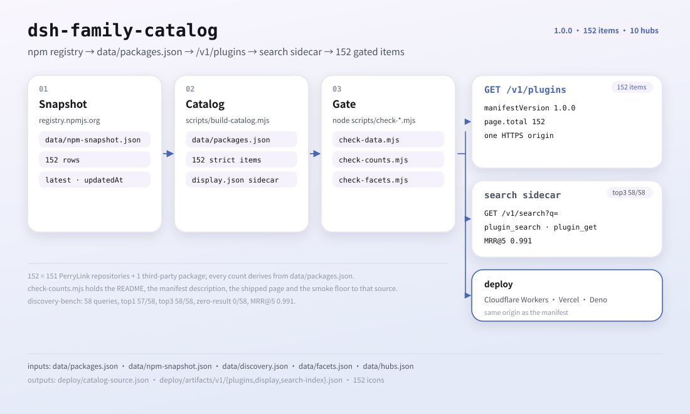
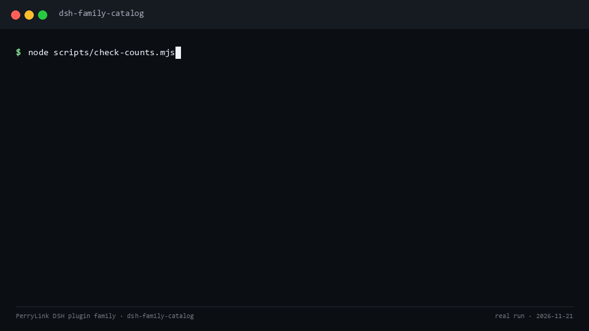

<picture>
  <source media="(prefers-color-scheme: dark)" srcset="docs/assets/dsh-family-catalog-hero-zh-dark.webp">
  
</picture>

# dsh-family-catalog

PerryLink DSH 插件家族的 DSH Community Market 标准目录源：152 个 npm 包（151 个家族仓 + 1 个第三方包），按公开 v1 契约校验后供 DSH Desktop 读取。

[English](README.md) · [简体中文](README-zh.md) · [Español](README-es.md) · [Português](README-pt.md) · [हिन्दी](README-hi.md)

> 本文件是简体中文本地化入口；完整技术文档以英文 [README.md](README.md) 为准，正文不在此重复翻译。

<picture>
  <source media="(prefers-color-scheme: dark)" srcset="docs/assets/dsh-family-catalog-flow-v5-dark.svg">
  
</picture>

*结构：npm registry → data/packages.json → 部署产物 → 门禁 → 搜索 sidecar。图内是真实的脚本名、路径与端点，五语共用一张图。*

## 维护状态：家族内部工具

*动图是本仓库自带的只读门禁与搜索 CLI 于 2026-11-21 的复跑：node scripts/check-counts.mjs、node scripts/check-facets.mjs、node scripts/search.mjs "IATF 16949" --limit=3。真实 stdout，不联网。*

本仓是 PerryLink 家族的**内部工具**，不退役：它把 152 个 npm 包盘点成 DSH Community Market 的标准目录源（151 个家族仓 + 1 个第三方包）。第三方并列收录不代表背书。

## 合规说明

遵循公开 v1 契约：`manifestVersion` / `schemaVersion` 为 `1.0.0`，条目只带 schema 允许的字段（`additionalProperties: false`），不输出安装命令或可执行数据；纯中文对与状态元数据放在 `display.json` 侧车。

## 构建

`node scripts/build-catalog.mjs` 生成 `deploy/catalog-source.json` 与 `deploy/artifacts/v1/plugins.json`，且 `data/` 与 `deploy/` 必须在同一次提交里成对更新。完整命令、门禁与 `pnpm run build:check` 的用法见英文 `README.md` 的 Build 一节。

## 部署

线上地址为 `https://perrylink-dsh-catalog.perrylink.workers.dev`，由 `.github/workflows/deploy.yml` 自动部署到 Cloudflare Workers；Vercel 静态重写与 Deno Deploy 为备选通道。manifest 与其端点必须位于同一 HTTPS origin。

## 在 DSH Desktop 中使用

在 DSH Desktop 的 市场 → **Sources** 添加 `https://perrylink-dsh-catalog.perrylink.workers.dev/catalog-source.json` 并选中即可浏览 152 条目录。浏览只读；安装仍走市场自身的 npm 身份校验与用户确认。

## 发现搜索与 MCP

`data/discovery.json`、`data/facets.json`（152/152 覆盖）与 `data/hubs.json`（10 个领域 hub）组成搜索 sidecar，提供 `GET /v1/search`、`GET /v1/plugin` 以及 stdio MCP 的 `plugin_search` / `plugin_get`。

## 中文说明

英文 `README.md` 内已含完整的中文技术说明一节；本文件只做本地化入口与摘要，不重复该节正文。

## 许可证

Apache-2.0。目录数据来自 npm registry 与 PerryLink 各插件仓库；家族当前线为 `dsh-v0.1.7-rc.2`。

## PerryLink DSH 插件家族

本仓属于 [PerryLink](https://github.com/PerryLink) 的 DeepSeek Harness 插件家族；可展开的完整家族名册在英文 [README.md](README.md) 中。

[Privacy](PRIVACY.md) · [Security](SECURITY.md) · [Contributing](CONTRIBUTING.md) · [Changelog](CHANGELOG.md)
